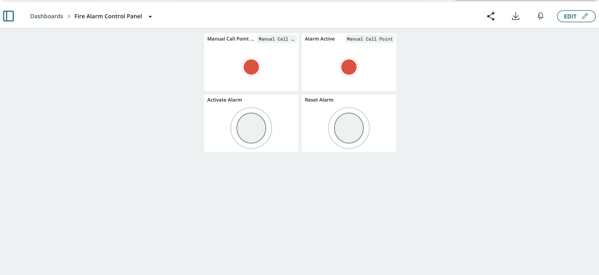
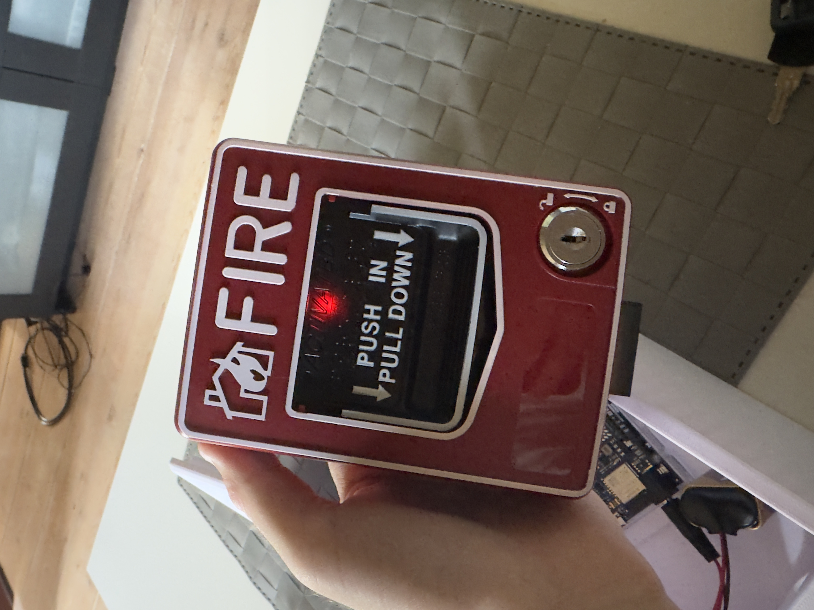
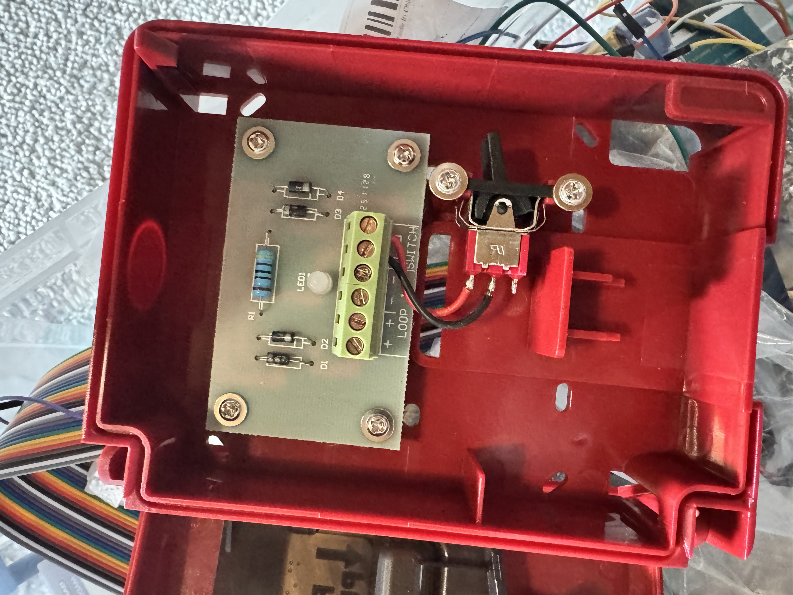
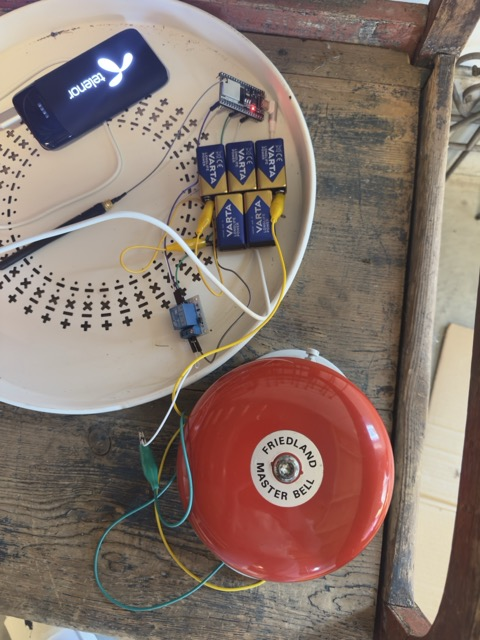

# Wireless IoT Alarm System 🚨

A smart, wireless IoT alarm system developed using Arduino and ESP32 microcontrollers. The system integrates hardware sensors, wireless communication, and cloud synchronization to provide real-time monitoring, activation, and alert states through a centralized dashboard.

### 📊 System Dashboard
Here is the centralized management interface built using Arduino Cloud to log triggers, handle remote alarm units, and sync data in real time:

### Features
- **Wireless Sensor Nodes:** Built using ESP32 and Arduino Uno R4 WiFi microcontrollers to communicate alert and reset states across a local network.
- **Cloud Synchronization:** Integrated with Arduino Cloud to handle remote alarm bell units and sync system states instantly.
- **Centralized Dashboard:** A digital interface designed for live system monitoring, manual activation, and system reset capabilities.
- **Manual Triggering:** Physical call point triggers integrated with hardware logic for instant response times.

### 🛠️ Hardware & Enclosure Setup
The hardware components, microcontrollers, and wiring are mounted inside custom enclosures. The system utilizes a manual call point trigger combined with remote bell units:

| Main Control Panel Setup | Internal Component Wiring | External Bell Unit |
| :---: | :---: | :---: |
|  |  |  |

### Technologies & Protocols Used
- **Microcontrollers:** Arduino Uno R4 WiFi, ESP32
- **IoT Platform:** Arduino Cloud (IoT Remote)
- **Languages:** C++ (Arduino Sketch)
- **Protocols & Connectivity:** Wi-Fi

### How to Access Code Sketches
The source code for this project is archived in the `src/` directory. 
- `MCPSketch.zip` contains the primary logic for the Main Control Panel.
- `FriedlandMasterbellSketch.zip` contains the logic for the receiver and bell actuator.

